# FootballEngine

A football management game where every result has a cause.


> **In development.** Playable from start to finish, far from finished. The first public demo is planned for January 2027.

## What we are building

You take a club and give it an identity. Then you watch it play that way.

* **Your club plays like you built it.** Tactics, training and signings show up on the pitch, not in a hidden number.
* **Rival managers learn.** They study you and answer in their own style. No tactic wins forever.
* **You can see why.** Lost 2 to 1? The tired full back you left on is in the replay.
* **People remember.** Players, the board and the press act on what you did to them.
* **The world moves without you.** Careers, rivalries and sackings happen whether you watch or not.
* **Mods come first.** The editor is a core feature, so anyone can build and share their own leagues.

## How the match works

Every match is a real simulation of 22 bodies and 22 minds, 40 times a second.

* Each player perceives, decides and moves. Nobody rolls a dice to pick the winner.
* The team thinks as a unit. Shape, pressing and transitions frame what each player chooses.
* The ball carrier plans a few moves ahead before passing, carrying or shooting.
* Fatigue hurts perception and judgement, not only speed.
* The ball has real flight, spin, bounce and drag.
* Same seed, same match, down to the last bit. Any result can be replayed and explained.
* Results are calibrated against real league statistics on matches the tuning never saw.

## Numbers

One full 90 minute match on a Ryzen 5 5600X:

| | |
|---|---|
| Time to simulate a match | 2.8 s on one core, 2.2 s with a second thread |
| Simulation steps per match | about 262,000 |
| Decisions by the ball carrier | about 42,000, each searching chains of up to 4 actions |
| Memory allocated per match | 93 MB |
| 48 match calibration run | 37 s |
| Automated tests | 1,279 |

## The match viewer

Every frame below comes from the simulation. The viewer only draws what the engine decided. All clips are from one seeded match, so anyone can replay them exactly.

| | |
|---|---|
| 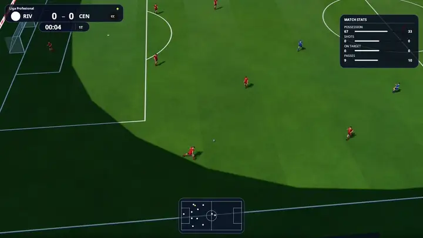 |  |
| **The same goal** from the broadcast camera. | **A late goal** from the touchline. |
| 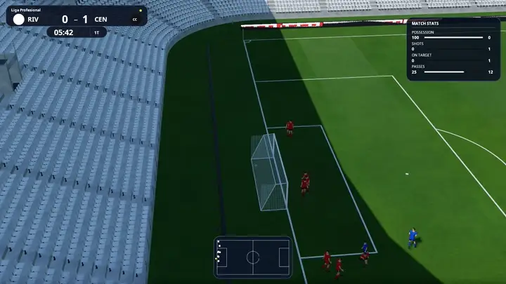 | 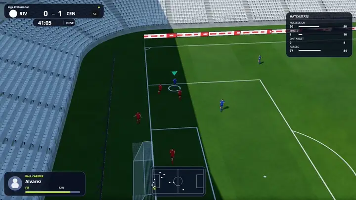 |
| **A scramble in the box,** cleared by the keeper. | **A counter attack** that ends in a save. |

Five cameras: broadcast, tactical, behind the goal, touchline and close up. The stadium is generated from the club's size and reputation.

| | |
|---|---|
| 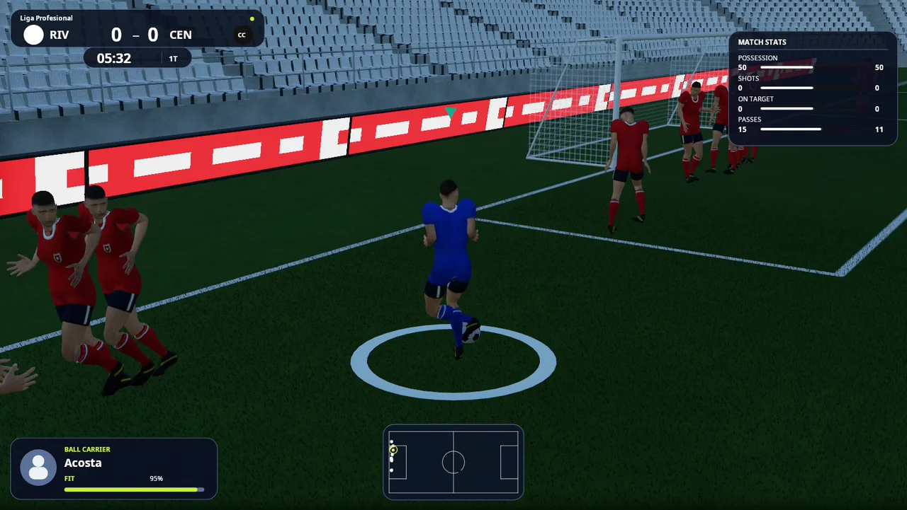 |  |
| 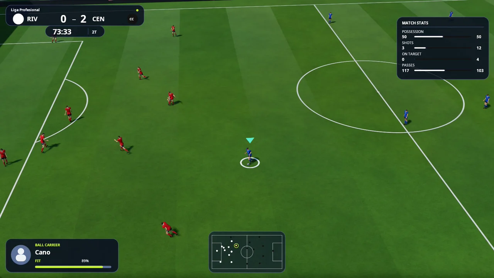 | 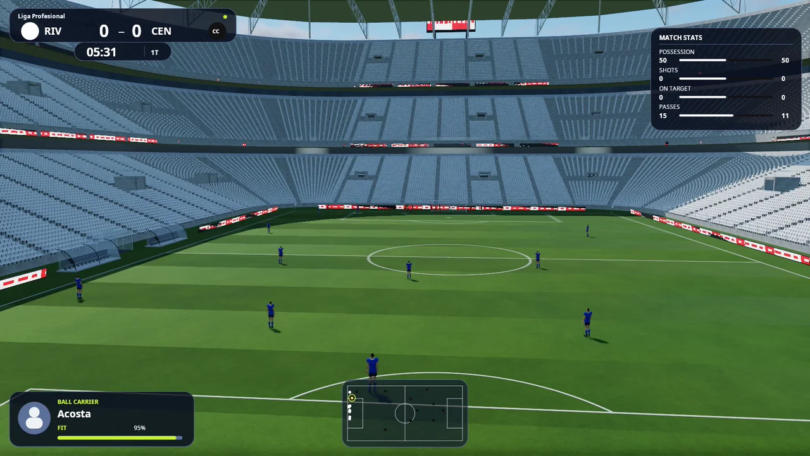 |

**Missing.** Crowd and crowd reactions, replays and slow motion, weather and night games, club badges in the scoreboard, and original player models and animations.

## A tour of the game

Screens from a real career, a few weeks into the season. Click a section to open it.

<details>
<summary><b>Today</b>: the next match and what needs you</summary>


**What it is for.** Your desk. The next opponent, how their manager plays, whether your lineup is ready and the messages that need a decision.

**What is different.** The rival manager has a personality and a record against you. The first time you meet, they have no reports on you. By the third, they know your habits. Time advances day by day and stops for a decision, an unavailable player or your match. It never plays for you.

**Missing.** A short summary of the last result and the form of both teams.
</details>

<details>
<summary><b>Tactics</b>: shape, roles and fit</summary>

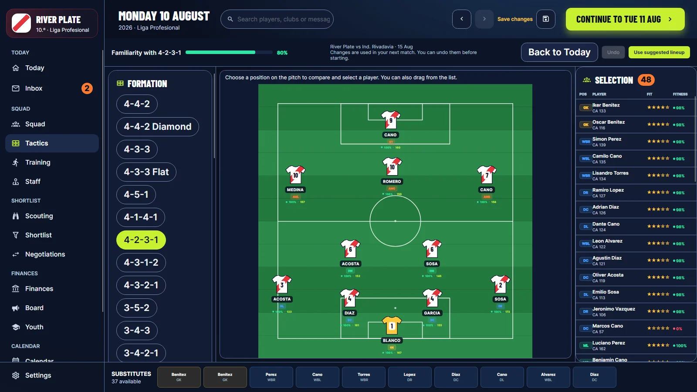

**What it is for.** Pick a formation, place your eleven, set the bench.

**What is different.** Every player shows how well they fit the role and how fresh they are. A familiarity bar shows how well the team knows this shape. Changing everything the day before a match has a real cost on the pitch.

**Missing.** Set piece routines and opposition instructions.
</details>

<details>
<summary><b>Squad</b>: who you have</summary>


**What it is for.** The whole squad by line, level, age or value, with condition and morale at a glance.

**Missing.** A richer player profile with history, personality and promises.
</details>

<details>
<summary><b>Training</b>: the week before the match</summary>

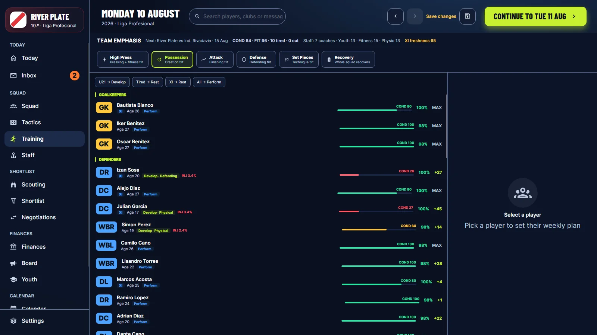

**What it is for.** Set the team's emphasis for the week and a plan for each player.

**What is different.** Training trades freshness for growth. Young players develop, tired players rest, the starting eleven sharpens. The page tells you how fresh your eleven will be on match day, and injury risk is visible before you choose.

**Missing.** Individual drills and staff advice.
</details>

<details>
<summary><b>Scouting</b>: knowledge has a cost</summary>


**What it is for.** Send a scout to watch a player, with a cost and a deadline.

**What is different.** You never see a player's true level. Reports give a range and a confidence, biased by how good your scout is.

**Missing.** Scouting regions and a better way to find targets than a long list.
</details>

<details>
<summary><b>Transfers</b>: the market</summary>


**What it is for.** Search players, follow targets, make offers and track incoming and outgoing deals.

**What is different.** Other clubs buy and sell on their own, all season, whether you are watching or not.

**Missing.** Loans and contract clauses.
</details>

<details>
<summary><b>Finances</b>: money you can trust</summary>


**What it is for.** Cash, transfer budget, wage commitments and a 30 day forecast.

**What is different.** Every operation is recorded, and money is reserved before a deal closes so it is never spent twice.

**Missing.** Match day income, sponsors and a clearer history view.
</details>

<details>
<summary><b>Board, news and inbox</b>: people who remember</summary>


**What it is for.** The board's confidence and the supporters' mood, the season objective and your recent results.

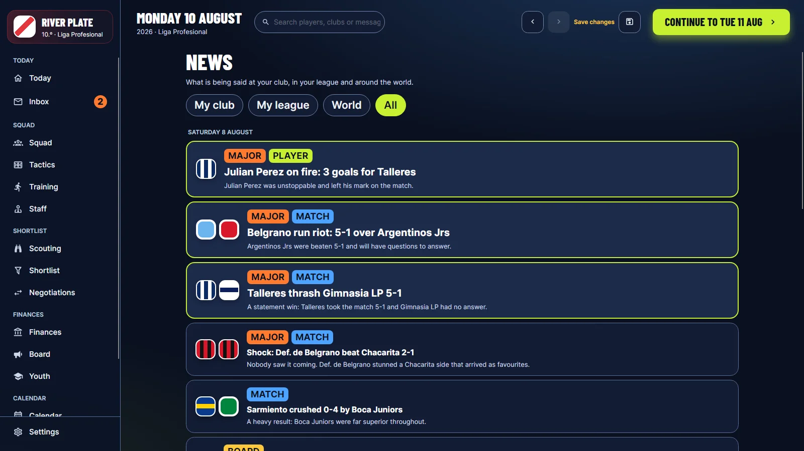

The news follows your club, your league and the world. Stories come from what really happened.


Messages that need you are marked for review. The rest can wait.

**Missing.** Press conferences, player conversations and situations that ask for a decision.
</details>

<details>
<summary><b>Calendar</b>: the season</summary>


**What it is for.** Every fixture and result of the season.

**Missing.** A month view and cup draws.
</details>

<details>
<summary><b>Mod editor</b>: build your own world</summary>


**What it is for.** Start a new world or edit a copy of a built in country. The original stays intact.


Clubs, kits, reputation and squads. Players you do not define are generated when a career starts. You can paste a squad from a spreadsheet.

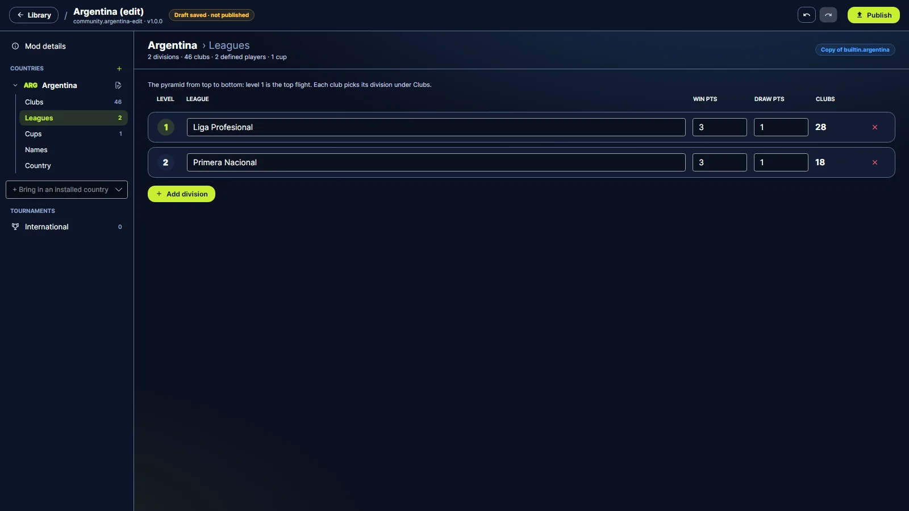

Leagues form a pyramid with their own points rules.

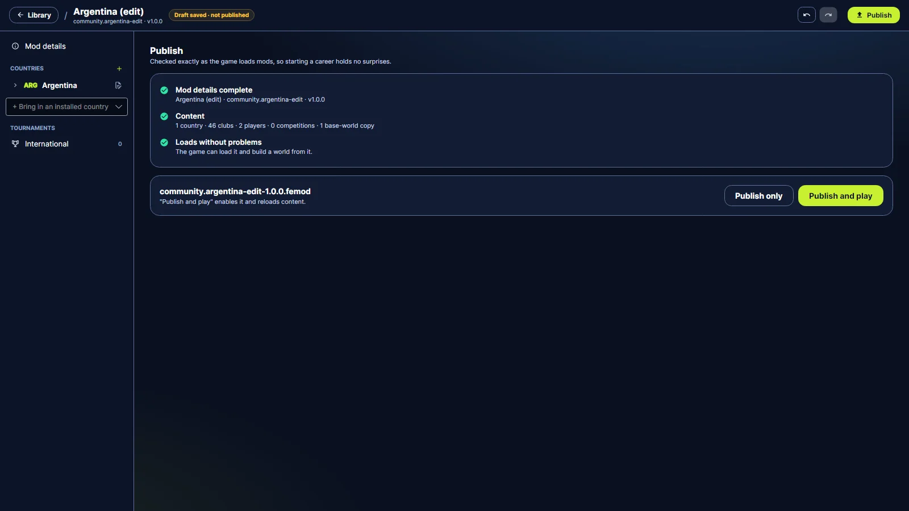

Publishing checks the mod exactly as the game loads it, so a career never starts broken.

**Missing.** Sharing mods online and editing competitions in depth.
</details>

## Status

Early and playable. You can start a career, run a season and watch every match in 3D.

**The 3D assets are placeholders.** Players, animations, the stadium and the crowd were generated by asking Claude to make them, and it shows. They are unpolished and will be replaced with our own work.

The built in leagues use real club names for testing. The game will ship with its own world, and the mod editor is how players bring in the leagues they love.

See the [roadmap](ROADMAP.md) for what comes next.

## Run it

You need the [.NET 10 SDK](https://dotnet.microsoft.com/download).

```bash
git clone https://github.com/DeltaBitsSystem/FootballEngine.git
cd FootballEngine
dotnet run --project FootballEngine.Client/FootballEngine.Client.fsproj -c Release
```

Run the tests with `dotnet fsi scripts/test.fsx`.

## Built with

F#, .NET 10, Avalonia, WebGPU and SQLite. Offline, no servers.

## Contributing

See [CONTRIBUTING.md](CONTRIBUTING.md). Design notes in `docs/` are mostly in Spanish.

## License

[GPL 3.0](LICENSE). The code is free, and anything built on it stays free.
