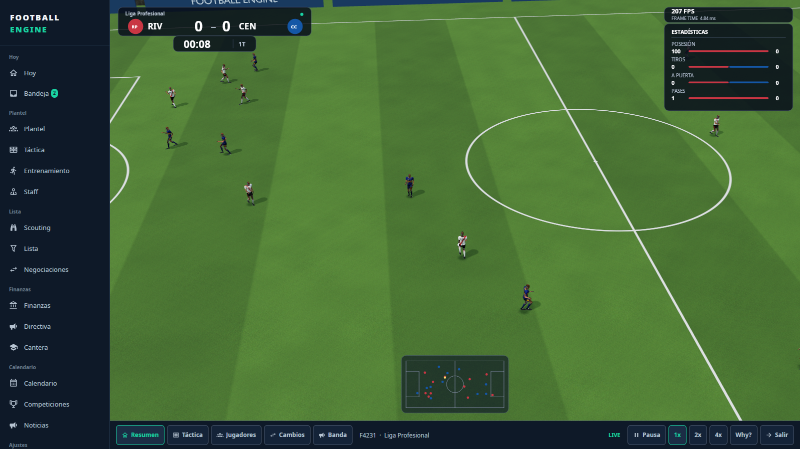
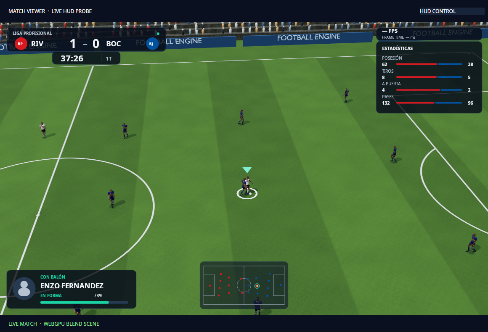

# Ball movement and foot contact

2026-10-07. [Design](../plans/BALL_FOOT_CONTACT_MOTION.md). Existing shared-worktree changes were preserved. The implementation is committed in the development review stack described in [the review guide](../reviews/DEVELOPMENT_STACK_2026_10_07.md).

## Current implementation

- `BallDynamics` owns free and controlled outfield motion. Supported balls do not accumulate gravity jitter. Flight uses world-space `omega cross velocity`; ground impact is resolved inside the step. Shell inertia couples slip to rotation, followed by rolling resistance and spin decay. Orientation is a normalized quaternion, not a function of viewer time.
- `BallFootContact` owns one pending strike and one motion envelope. Passes, crosses, shots, clearances and foot restarts prepare before contacting. Ownership, active participation, reach, height and flow are checked before commitment. Cancellation produces an event, never a remote kick. The actual ball location becomes the strike origin; an off-centre surface lever explains the angular impulse. Throw-ins remain hand actions.
- Outfield control uses intermittent velocity impulses, never position attachment. Reception absorbs relative velocity at first touch. Moving loose balls can be trapped without waiting for a stationary timer. Contact candidates must be within physical reach and height; a predicted race is not possession. Goalkeeper hand holding is the explicit attachment exception.
- Offside snapshots and successful cross launch evidence are captured at actual strike contact. A prepared strike retains its original decision cause until commitment. Restart cancellation returns to positioning; contact completion is observed through the next tick's event reduction, not inferred from a disappearing impulse.
- Motion envelope times use **end-of-step pose boundaries**, matching replay positions. Impulse/event ticks identify the producing step. This avoids a one-tick animation/physics offset without allocating a separate visual history.
- Replay format **10** stores radius, all angular-velocity axes, quaternion orientation, contact point, ball centre and foot timeline. Older formats are rejected. No legacy physics/renderer branch remains; obsolete reception-margin/race configuration and pre-launch offside rejection were removed.
- Training calibrates reception velocity retention and pass rolling spin directly; the old interception-margin and receiver-bonus knobs were removed rather than aliased.
- The viewer uses authored left/right pass, shot and reception clips with their manifest impact markers. A bounded two-bone solve rotates rigid bones and preserves segment lengths; it cannot move the ball or change sporting results. Unreachable animation targets clamp instead of stretching. Interpolation splits at contact; outgoing velocity cannot bend the pre-contact path. Spin-aware quaternion interpolation retains turns larger than pi per pose instead of visibly reversing fast rolling spin. Pause/seek sampling has no accumulated renderer state.

## Performance

Local Linux/XWayland system, Ryzen 5 5600X / RX 5500 XT. Diagnostics run without concurrent test suites; these are observations, not cross-device guarantees.

### Core

`BallMotionBench.fsx`, Release Core, five batches of 500,000 ticks; mixed flight/landing/rolling trace resets every 200 ticks. The first batch includes tiered-JIT effects and is not the steady-state figure.

- Final warmed motion kernel: approximately **94 ns/tick**, **0 managed bytes/tick** (four warmed batches: 94.0, 94.0, 93.8 and 94.0 ns; first tiered-JIT batch: 266.1 ns).
- Changing previous-position history from a heap option to a value option removed **64 bytes/tick** from the same kernel trace. No speedup relative to the original match engine is claimed.
- Contact selection scans roster slots and retains a value-tuple winner, without candidate arrays or tuple boxing. Tests gate zero managed allocations for the motion kernel and reachable-contact search.
- This microbenchmark excludes cognition, events, replay encoding, full-match allocation and GPU work. Contact events and replay envelopes are not claimed to be allocation-free.

### Viewer

Debug probe, 1160x698 GPU surface, unchanged anatomical mesh, material/HDR pipeline and 4x MSAA. Mailbox, no GPU-completion wait, 600 presents, first 15 omitted:

| Scenario | Median submission/backpressure | p95 | Present calls/s |
|---|---:|---:|---:|
| Existing locomotion trace | 4.546 ms | 5.163 ms | 213.9 |
| One right-foot contact + IK every frame | 4.559 ms | 5.202 ms | 212.9 |

The 0.013-ms median difference is within ordinary local variability; this is **not a GPU timestamp measurement**. The contact probe pins an impact pose as a workload, not a simulated match. Managed renderer/probe allocations were 79,828 versus 80,316 bytes/frame; HUD pixel uploads remained 102,123 bytes/frame. No FPS cap or quality reduction was introduced.

## Validation and visual evidence

The dedicated tests cover rest, dissipative slip, landing, direction-correct Magnus, unit orientation, torque from a surface lever, preparation/one-time commit, cancellation, physical loose-ball trapping/height, replay round trip/old-format rejection and allocation gates. Client tests cover authored markers, rigid bone lengths, support-leg isolation, nearby left/right boot contact error under **3 cm**, contact-aware interpolation and fast-spin alias prevention.

- **545/545 Core tests pass; 139/139 Client tests pass.** No ignored or errored tests.
- The full solution builds, including Training; Client.Tests and the native renderer probe also build separately. `git diff --check` passes.

Native captures of preparation, impact and recovery were inspected. They are fixed synthetic poses, not a temporal quality certification; the broadcast camera and a nearby synthetic opponent limit close-up detail. The real deterministic application match was also inspected through its X11 parent; its capture showed **207 FPS / 4.84 ms**, a screenshot observation rather than a percentile study.





## Reproduce

```bash
dotnet build FootballEngine.Core/FootballEngine.Core.fsproj -c Release --no-restore
dotnet fsi Tools/MatchViewer3D/BallMotionBench.fsx
dotnet run --project FootballEngine.Core.Tests/FootballEngine.Core.Tests.fsproj
dotnet run --project FootballEngine.Client.Tests/FootballEngine.Client.Tests.fsproj
dotnet build Tools/MatchViewer3D/StadiumRendererProbe.fsproj --no-restore
MATCHVIEWER_PROBE_CONTACT=right MATCHVIEWER_PROBE_MEASURE=1 MATCHVIEWER_PROBE_WAIT_GPU=0 MATCHVIEWER_PROBE_FRAMES=600 dotnet run --no-build --project Tools/MatchViewer3D/StadiumRendererProbe.fsproj
MATCHVIEWER_PROBE_CONTACT=right MATCHVIEWER_PROBE_CONTACT_PHASE=prepare MATCHVIEWER_PROBE_FIXED_POSE=1 MATCHVIEWER_PROBE_FRAMES=150 MATCHVIEWER_PROBE_CAPTURE=/tmp/opencode/contact-prepare.png dotnet run --no-build --project Tools/MatchViewer3D/StadiumRendererProbe.fsproj
```

For impact omit `MATCHVIEWER_PROBE_CONTACT_PHASE`; for recovery use `recover`. Use `left` to exercise the other boot. Avalonia bitmap screenshots omit the GPU child; capture the native X11 parent with `import -window <XID> <path>`.

## Boundaries

This is a deterministic reachable-effector/rigid-sphere model, not triangle-level foot collision or a generic rigid-body engine. IK does not impose full anatomical joint limits or certify boot contact across every posture; clamped targets expose the need for better authored poses rather than stretching the leg. Sparse offline replay sampling may omit intervening touch envelopes; live policy retains every simulation pose. Goalkeeper-hand authoring, whole-body ball impacts, contact-patch deformation, turf microstructure and net simulation are outside this change. Reception and sporting outcomes retain the engine's attribute/probability models. FIFA superiority is not claimed without an equivalent temporal comparison.
