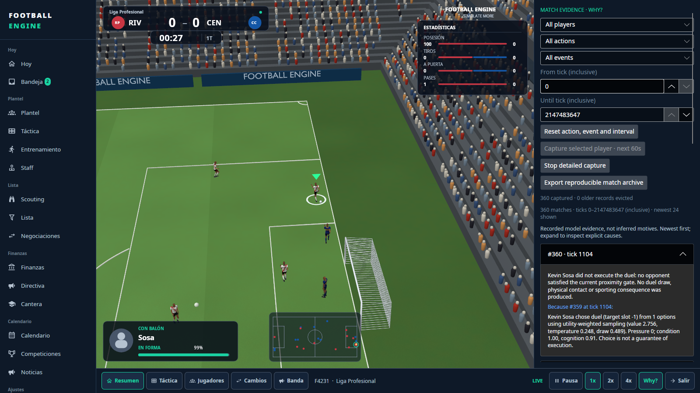
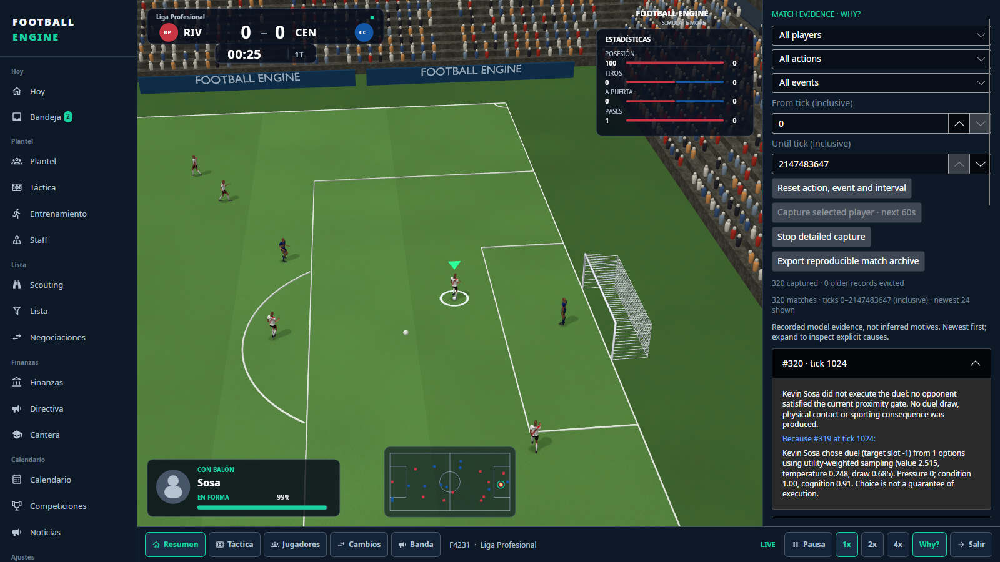

# Broadcast materials — first rendering cut

Date: 2026-10-06. User-selected direction: realistic football broadcast. This is an initial material improvement, **not AAA certification** or a completed texture/lighting pipeline.

## Implemented

- Explicit stadium surface identity in the vertex ABI, distinct from colour, UVs and skin weights. Grass stripes/runoff, concrete, steel and enamel have separate material responses. Kits, chalk, HUD and marker do not inherit terrain detail because of colour similarity.
- First-party world-space procedural surface textures: smooth broad variation, restrained local variation and fine grain. Detail fades according to screen-space derivatives instead of shimmering below pixel scale. No imported third-party imagery, new download or asset licence claim.
- Reduced mowing-band colour contrast and synthetic green; slight directional surface normal for the cut turf. Concrete remains rough; steel/enamel have separate roughness and metallic responses. GGX-style direct-light response is evaluated independently of the athlete atlas path.
- Character anatomy, rig, atlas files, stadium geometry and engine outcomes are unchanged. Character loader only populates the new presentation-only surface attribute.
- Probe now routes WebGPU trace diagnostics to stderr: runtime shader validation failures cannot hide behind a successful F# build. Initial shader keyword error was corrected before accepting the screenshot.

## Validation

```bash
dotnet build FootballEngine.Client/FootballEngine.Client.fsproj
dotnet build Tools/MatchViewer3D/StadiumRendererProbe.fsproj
dotnet run --project FootballEngine.Client.Tests/FootballEngine.Client.Tests.fsproj
MATCHVIEWER_PROBE_FIXED_POSE=1 MATCHVIEWER_PROBE_CAMERA_SCENE=midfield timeout --kill-after=3s 60s dotnet run --no-build --project Tools/MatchViewer3D/StadiumRendererProbe.fsproj
DOTNET_GCHeapHardLimit=0x40000000 timeout --kill-after=5s 75s dotnet run --no-build --project FootballEngine.Client/FootballEngine.Client.fsproj -- --shots /tmp/opencode/broadcast-materials-match --shots-pages match --shots-settle 45000 --match-evidence
git diff --check
```

Client **101/101**. Vertex stride 88 bytes, surface attribute offset 84: regression checks material data does not overlap joints/weights. Material-name mapping checks authored stripe suffixes and plain kits/chalk. Probe initialized and presented without logged WebGPU validation errors after the fix. The bounded real match capture completed normally; screenshot below uses the actual X11 window because RenderTargetBitmap omits the external GPU surface.



Screenshot inspected: lines, athletes, HUD and evidence inspector remain visible; grass has restrained variation. No same-camera before/after baseline was captured, so this is not an A/B quality or GPU performance measurement.

## Still required for the requested high-end result

- Authored/photographic PBR material maps with provenance, repeat scale, normal/roughness/AO conventions, linear-light mip generation and anisotropic filtering, and their offline asset pipeline.
- Contact and stadium shadows, ambient/image-based lighting and calibrated exposure. Current direct lighting is not a complete physically based environment.
- Grass close-up detail/LOD, pitch wear with intentional art direction, richer seating/supporter materials, and athlete skin/fabric refinement without overwriting ongoing asset work.
- Same-camera/daylight/floodlit comparisons, moving sequences to assess temporal aliasing, and CPU/GPU measurements at target resolutions. Static screenshots cannot certify those requirements.

## Follow-up: real offline maps and reduced contact shadows

Implemented 2026-10-06 after authorization to use Internet/Blender:

- Consulted the user's Blender (5.2.2 LTS) read-only; scene and shared anatomy/equipment assets were not modified. Poly Haven grass assets were reviewed but not imported because their soil/leaves/weeds would contradict a maintained football pitch.
- Added project-owned repeating cut-turf maps and Poly Haven Concrete Floor 02 (Rob Tuytel, CC0-1.0), using the public asset download URLs and published MD5 verification. Source/download/processed SHA-256 and attribution live in `Assets/MatchViewer/Surfaces/manifest.json`; legal provenance is in `LICENSES.md`. No online resource is needed to play/build.
- Three GPU texture arrays carry albedo, OpenGL normal and AO/roughness/metallic. Full 11-level mip chains are generated offline; sRGB colour is reduced in linear light and normals are renormalized. Repeat scale is two metres; sampler is trilinear with 8× anisotropy. Texture resource lifecycle handles initialization failure and disposal alongside the other GPU resources.
- Added sun-projected reduced player and ball proxy/contact shadows on pitch grass. Proxies follow renderer root transforms and ball height. These are **not mesh-silhouette/stadium shadow maps**, do not capture arm/leg pose or goal-net occlusion, and never affect simulation.
- Client full suite **103/103** after fixing structured rejection of InvalidDataException. Positive pack-size/hash/mip validation and tamper rejection are covered. An offline rebuild regenerated byte-identical manifest/hashes. Probe initialized/presented without logged validation errors before the user stopped it; the stop was not an application failure and was not used as grounds to restart the probe.
- A bounded real match run subsequently completed normally. Native screenshot inspected below: grass/map detail and player shadows visible; HUD/inspector still render. This is not a measured GPU performance claim or certification of AAA quality.



The high-end objective is **not complete**: full geometry/stadium shadows, HDR/image-based lighting, skin/fabric/subsurface refinements, higher-detail seating/supporters, close-up grass LOD and temporal/GPU performance validation remain. The former list above describes the initial state; this follow-up supersedes its unimplemented map/filtering items only.
