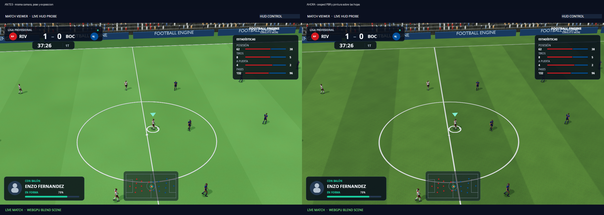
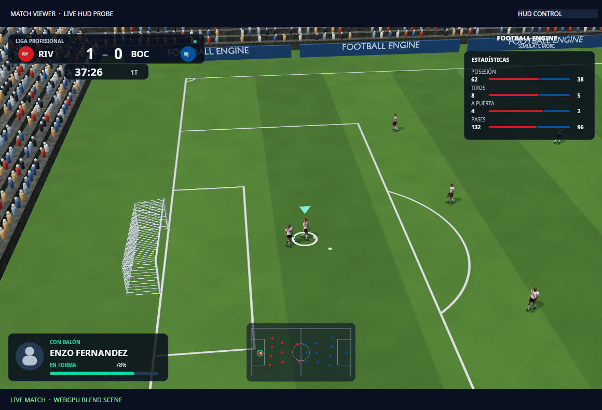
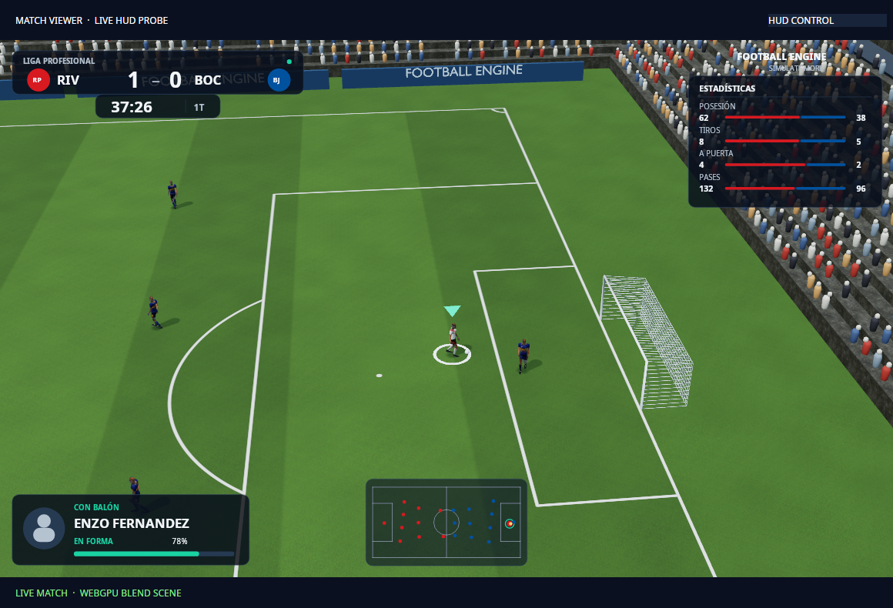
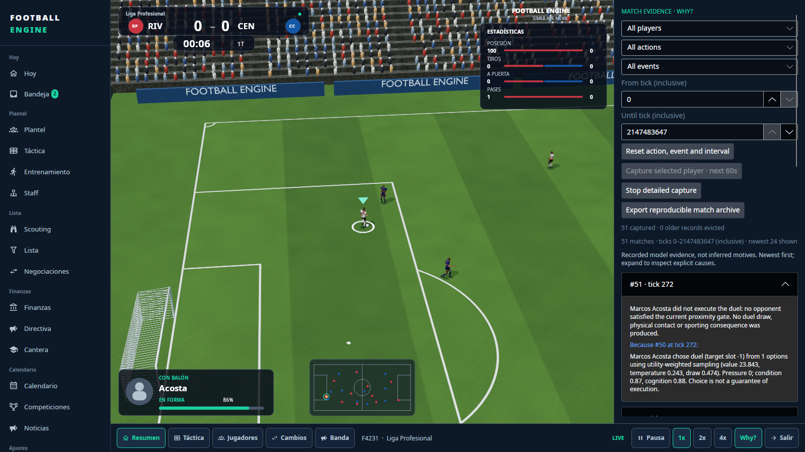

# Pitch turf and markings — realistic broadcast material

2026-10-06. Scope: **grass and painted field lines only**. FIFA/EA Sports is an art-direction reference, not a source of assets or a claim of identical visual quality.

## Implemented

- Replaced the simplistic generated blade texture with ambientCG Grass004 (CC0-1.0): colour, OpenGL normal, roughness and occlusion. Source URLs/licensing and pinned source/output SHA-256 are recorded with the offline asset pack. Pitch colour is calibrated in linear light; detail remains at the source's 1.4-metre scale rather than stretching one image across the pitch.
- Continuous triangular stochastic tiling, explicit texture gradients, full linear-colour/renormalized-normal mip chains and existing 8× anisotropic filtering. Broad clump variation is restrained; no frame-randomized noise or isolated repeated tufts.
- Fourteen 7.5-metre mowing passes with view-dependent response and blade-normal direction. They use one material instead of the authored GLB's two arbitrary green colours. Subtle static goal-mouth colour wear is visual art direction only.
- Replaced all raised chalk meshes with analytic paint on the grass surface. Boundary, halfway, center circle/spot, both penalty/goal areas, clipped penalty arcs, penalty spots and four corner arcs share the same metre-based geometry. Twelve-centimetre strokes and footprint filtering retain fine distant lines. Paint retains grass normals and local occlusion, rather than acting like a floating white ribbon.
- `PitchMarkings.fs` provides shared geometry constants and CPU reference distances; `PitchSurface.wgsl` owns the single grass/paint rendering path. No legacy turf shader or parallel geometry markings remain in runtime. Source Blender/GLB assets were not overwritten.
- Player shading, geometry, rig, equipment, stadium materials, illumination/exposure, UI and sporting simulation are unchanged by this cut. Concrete's complete mip/layer bytes were compared before/after pack regeneration and are identical. The repository allowlist now includes the required shader/material bundles so a clean checkout can render offline.

## Validation

```bash
python3 Tools/MatchViewer3D/build_surface_pack.py
dotnet build Tools/MatchViewer3D/StadiumRendererProbe.fsproj
dotnet run --project FootballEngine.Client.Tests/FootballEngine.Client.Tests.fsproj
MATCHVIEWER_PROBE_FIXED_POSE=1 MATCHVIEWER_PROBE_CAMERA_SCENE=midfield MATCHVIEWER_PROBE_FRAMES=45 MATCHVIEWER_PROBE_CAPTURE=/tmp/opencode/pitch-midfield.png dotnet run --no-build --project Tools/MatchViewer3D/StadiumRendererProbe.fsproj
DOTNET_GCHeapHardLimit=0x40000000 timeout --kill-after=5s 75s dotnet run --no-build --project FootballEngine.Client/FootballEngine.Client.fsproj -- --shots /tmp/opencode/pitch-final-match --shots-pages match --shots-settle 45000 --match-evidence
git diff --check
```

Client **121/121**. New tests cover line width, filled spots, penalty/goal boxes, clipped arcs, corners, field clipping, symmetry, shader constants, removal of raised paint, retained materials and matching the authored grass footprint. An offline rebake reproduced identical manifest/output hashes. The probe exits nonzero on WebGPU validation errors; midfield, both goals and both touchlines completed with exit 0 and screenshots were inspected.

Moving run: 120 frames, 105 measured after warmup; completed-frame median **8.142 ms**, p95 **9.022 ms** on this machine. This includes HUD/CPU submission and a GPU completion wait, **not GPU timestamps**, a cross-device guarantee or a controlled before/after benchmark. Static screenshots also cannot certify temporal aliasing for every camera path.

The deterministic real match capture completed normally; native X11 screenshot includes the external GPU surface omitted by Avalonia RenderTargetBitmap.

## Visual evidence

Same camera, fixed pose, exposure and HUD:



Both ends inspected for arc joins, painted spots, borders and corners:




Real application:



This cut targets the actual broadcast camera. It does not add individual 3D grass blades, close-up turf displacement, dynamic divots or new stadium shadows; those would be different rendering features. It does not certify complete AAA parity or legal coverage of the sporting rules engine.
