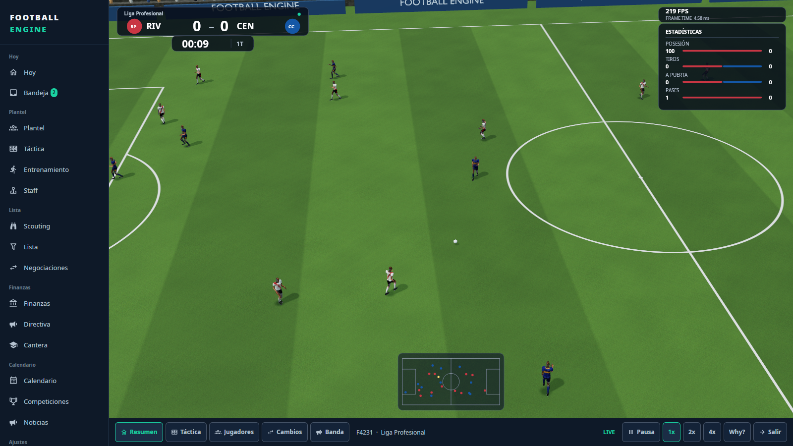

# Match viewer: rendering performance

2026-10-07. Design written before implementation: [retained GPU rendering plan](../plans/MATCHVIEWER_RENDER_PERFORMANCE.md). Worktree already contained extensive match-engine, assets and renderer work; those changes were preserved.

## Delivered architecture

- One `RenderWorker` owns construction/render/disposal and the private Xlib connection on a dedicated thread. A latest-input mailbox prevents stale layout queues. Idle/hidden/no-snapshot states wait for UI publication rather than spinning. Failed surface acquisition yields to the next publication. Native resources unwind before error reporting; detach joins before the parent disappears.
- `PresentationLoop` is an attachment-generation-guarded Avalonia animation callback chain for **layout/visibility publication only**. No renderer timer, fixed FPS cap or production GPU completion wait remains. Request a high-performance adapter; use tear-free Mailbox where supported and FIFO otherwise, through the same pipeline. Surface acquisition provides native backpressure.
- One canonical character vertex/index mesh, 22 GPU instances. WGSL instance identity selects root transform, skeletal palette and away kit UV offset. Mesh topology, clip sampling, shaders' material calculations, turf, HDR and 4x MSAA were not reduced.
- Persistent HUD bitmap/canvas and texture, native-pointer uploads of bounded changed rectangles. No full-surface managed byte-array allocation or Marshal.Copy in runtime. The minimap updates at renderer frequency, not at a throttled text/UI cadence. Theme/locale and resize invalidate fully; carrier loss clears the old card and marker. Pixel tests compare against fresh rendering (one-byte tolerance for Skia clipped-edge rounding).
- Projection caches only the two sampled endpoint snapshots, owned by the render thread. The authoritative simulation/presentation stream contract was not changed.

## Measurements

Linux/XWayland, same local Ryzen 5 5600X / RX 5500 XT system used for prior viewer evidence; Debug builds, default HDR daylight and 4x MSAA. Synthetic moving 22-player trace; 1160x790 window with 1160x698 GPU surface; first 15 frames excluded. No measurements run concurrently with test suites. Numbers are local observations, not cross-device guarantees or GPU timestamp measurements.

| Run | Samples | Work median | Work p95 | Present calls/s |
|---|---:|---:|---:|---:|
| Before, inherited 30-Hz probe timer, GPU completion awaited | 165 | 8.236 ms | 9.127 ms | timer-constrained |
| After, explicit 33.333-ms diagnostic delay, GPU completion awaited | 165 | 6.432 ms | 7.219 ms | 25.2 |
| After, dedicated worker, GPU completion awaited | 285 | 6.256 ms | 6.640 ms | 159.4 |
| After, production-style worker, **no completion wait** | 585 | 4.602 ms submission/backpressure | 4.943 ms submission/backpressure | **214.5** |

The similarly paced completed-work comparison is about **22% lower median / 21% lower p95**. The old timer and new explicit diagnostic delay are not identical scheduling mechanisms; these are identical-size/trace workload observations, not a controlled GPU-frequency benchmark. Do not compare the 4.602-ms asynchronous submission measurement directly with the old CPU+GPU-completion measurement as if they measured the same quantity.

Production-style run: mean HUD pixel upload payload **102,182 bytes/frame** versus the old full image's **3,238,720 bytes/frame**, approximately **96.8% less**. New measured renderer/probe managed allocations average **79,772 bytes/frame**; no corresponding baseline allocation counter was recorded, so no measured allocation-speedup ratio is claimed. The old image byte array alone was 3,238,720 bytes. Character geometry storage is exactly **1/22** of the replicated layout; both teams retain the same anatomical geometry and different atlas halves.

Native capture of a real deterministic application match (1600x900 window, 1380x843 GPU surface) showed **219 FPS / 4.58 ms** in the half-second counter. This is a screenshot observation, not a full-match FPS percentile study. Mailbox render/present throughput can exceed display refresh; the monitor does not show all 219 submissions per second.



## Validation

- Client builds successfully; **136/136 Client tests pass** (15 added tests for HUD invalidation/pixel equivalence/theme/language, presentation-loop generations and renderer-thread ownership/mailbox/error/teardown).
- Character tests migrated to the new single-mesh contract and compare its vertex count with the authored GLB. Required animation/atlas/hash tests still pass.
- Native moving probe screenshots inspected: both kit atlas halves, turf/paint, camera, carrier HUD and minimap preserved.
- Resize 1160x698 → 940x578 → 1160x698 successfully recreated the surface/HUD and rendered after restoration; screenshot inspected.
- Ten short attach/detach cycles plus three 2.5-second active cycles: matching attach/detach counts; all three long cycles presented live frames.
- Probe validation listener reports no uncaptured WebGPU errors (all probes exit 0). Real application's deterministic screenshot run also exits 0. `git diff --check` passes.

## Reproduce

```bash
dotnet build FootballEngine.Client/FootballEngine.Client.fsproj --no-restore
dotnet build Tools/MatchViewer3D/StadiumRendererProbe.fsproj --no-restore
dotnet run --project FootballEngine.Client.Tests/FootballEngine.Client.Tests.fsproj

# Production-style submission/backpressure and actual presentation cadence.
MATCHVIEWER_PROBE_MEASURE=1 MATCHVIEWER_PROBE_WAIT_GPU=0 MATCHVIEWER_PROBE_FRAMES=600 MATCHVIEWER_PROBE_CAPTURE=/tmp/opencode/viewer-performance.png dotnet run --no-build --project Tools/MatchViewer3D/StadiumRendererProbe.fsproj

# Diagnostic completion wait, not production behavior.
MATCHVIEWER_PROBE_MEASURE=1 MATCHVIEWER_PROBE_FRAMES=300 dotnet run --no-build --project Tools/MatchViewer3D/StadiumRendererProbe.fsproj

# Explicit baseline-like diagnostic pacing; no effect on the real viewer.
MATCHVIEWER_PROBE_MEASURE=1 MATCHVIEWER_PROBE_INTERVAL_MS=33.333333 MATCHVIEWER_PROBE_FRAMES=180 dotnet run --no-build --project Tools/MatchViewer3D/StadiumRendererProbe.fsproj

MATCHVIEWER_PROBE_RESIZE=1 MATCHVIEWER_PROBE_FRAMES=300 MATCHVIEWER_PROBE_CAPTURE=/tmp/opencode/viewer-resize.png dotnet run --no-build --project Tools/MatchViewer3D/StadiumRendererProbe.fsproj
MATCHVIEWER_PROBE_CYCLES=3 MATCHVIEWER_PROBE_CYCLE_MS=2500 dotnet run --no-build --project Tools/MatchViewer3D/StadiumRendererProbe.fsproj
dotnet run --no-build --project FootballEngine.Client/FootballEngine.Client.fsproj -- --shots /tmp/opencode/viewer-real-match --shots-pages match --shots-settle 20000
git diff --check
```

Avalonia's bitmap screenshot omits the native GPU child. To verify the real application image, capture its X11 parent while the deterministic shots window is open, using `import -window <XID> <path>`; the screenshot above uses that workflow, not a Blender render.

## Limits

No GPU utilization/timestamp counters or long-session VRAM soak were collected. FIFO-only devices retain refresh pacing. Wayland-native/Windows/macOS support was not added. This replaces the identified CPU/upload/memory bottlenecks; it does not claim every GPU is saturated or that future assets/scenes need no visibility/LOD optimization. No speculative compute-animation, indirect drawing, lower-quality material path or legacy renderer was introduced.
